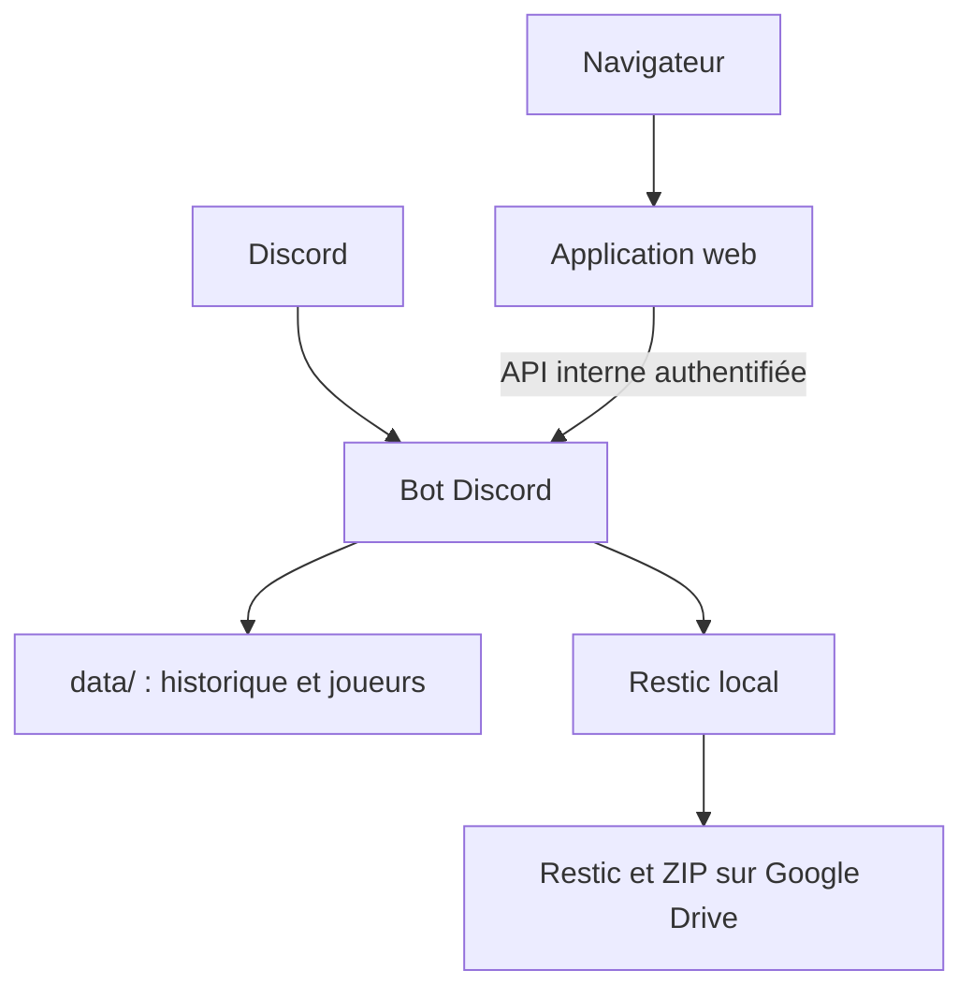

# Architecture et repères dans le code

Ce document décrit l'organisation actuelle ; pour le vocabulaire métier, voir le [glossaire](../GLOSSARY.md), et pour les commandes utilisateur, le [README](../README.md).

## Vue d'ensemble



Le bot est le processus qui écrit l'état en fonctionnement normal. L'application web n'a pas de volume `data/` : elle lit et enregistre via l'API interne du bot. Les scripts de maintenance et de restauration peuvent aussi écrire les fichiers ; ils doivent être utilisés avec précaution et sans autre écrivain concurrent.

## Points d'entrée

- [`bot.py`](../bot.py) charge le token, valide ou migre l'état, enregistre les commandes `t/` et démarre l'API interne après la connexion Discord. Il gère aussi l'édition des messages `t/auto` et `t/edit` en attente.
- [`tarot_web/__main__.py`](../tarot_web/__main__.py) démarre l'application aiohttp définie dans [`tarot_web/app.py`](../tarot_web/app.py). Elle sert les pages et ressources dans `tarot_web/templates/` et `tarot_web/static/`, dont le favicon représentant le Petit (`favicon.svg`), gère la connexion Discord et appelle l'API interne.
- [`debug_bot.py`](../debug_bot.py) et [`tarot_debug/`](../tarot_debug/) fournissent un faux bot, une console et des données factices pour la stack de debug. Le faux bot n'exerce pas l'intégration réelle avec Discord.
- Le [`Dockerfile`](../Dockerfile) construit les cibles `bot`, `web` et `debug-bot`. Les fichiers Compose choisissent les services et leurs réseaux ; voir [Déploiement](deploiement.md).

## Connexion web

En prod, `/auth/discord` lance la connexion OAuth Discord et l'accès reste réservé aux membres du serveur configuré. En debug, la page de connexion propose à la place une connexion fictive : le navigateur suit la même adresse `/auth/discord`, qui crée une session localement sans contacter Discord. Après déconnexion, la page de connexion permet de recommencer.

Les sessions web de debug et leurs aperçus sont isolés entre navigateurs : la déconnexion d'une session n'affecte pas les autres. Les données factices et la console du faux bot restent communes à l'environnement de debug : ses commandes en attente sont partagées et une réinitialisation affecte tous ses utilisateurs. Cette connexion fictive n'est pas une protection par mot de passe et ne valide pas le parcours OAuth de prod ; l'accès à la stack reste limité au réseau local.

## État et données

Dans le conteneur bot, `/data` est le répertoire de travail et correspond à `./data` sur l'hôte :

- `history.json` est la source des scores : chaque partie contient notamment un objet `scores` par joueur.
- `players.json` contient les noms inscrits, y compris ceux qui n'ont pas encore joué. Les noms présents dans l'historique sont également reconnus.
- Les saisons précédentes sont des répertoires dans `data/` ; `t/new_season` archive les fichiers courants avant de repartir à zéro.
- `restic/` est le dépôt local de sauvegarde ; `curves.png` est un fichier généré.

[`tarot_commands/state.py`](../tarot_commands/state.py) valide les formats, calcule les totaux à partir de l'historique et assure les écritures JSON atomiques. Au démarrage, `migrate_state()` initialise les fichiers manquants et migre les anciens formats après validation. Chaque fichier est remplacé atomiquement, mais plusieurs fichiers ne sont pas une transaction unique. Il n'y a pas de verrou global entre processus : ne pas démarrer une deuxième instance sur les mêmes données.

## Parcours d'une partie

1. Côté Discord, [`tarot_commands/game.py`](../tarot_commands/game.py) interprète la saisie, calcule les scores et gère les interactions de confirmation ; [`sessions.py`](../tarot_commands/sessions.py) porte les sessions en attente. Les règles et constantes sont dans [`rules.py`](../tarot_commands/rules.py).
2. Côté web, `app.py` gère la saisie et la prévisualisation ; [`web_game.py`](../tarot_commands/web_game.py) valide les données métier. La page `/game` propose une interface adaptée au mobile, accessible depuis le classement ; les joueurs et les rôles y sont choisis par cartes, avec une liste de joueurs sur trois colonnes même sur mobile et une distinction entre attaque et défense. À trois ou quatre joueurs, « Valider » en haut de la carte replie la liste avec un résumé ; à cinq joueurs, elle se replie automatiquement ; après le choix du preneur ou du partenaire, ses cartes se replient aussi. Chaque sélection reste modifiable. La section repliée des primes et misères résume les choix de chaque camp et les joueurs concernés. Après le calcul, une redirection vers une page d’aperçu permet d’actualiser sans renvoyer le formulaire ; les données et le résultat restent en session, pas dans l’URL. La page expire lorsqu’un autre aperçu est calculé, après enregistrement ou à la fin de la session. Le récapitulatif met en avant la confirmation ; modifier la saisie retire l’aperçu et réaffiche le bouton de calcul (sans JavaScript, un bouton permet de recalculer). Actualiser l’aperçu restaure la dernière saisie calculée, pas les modifications non recalculées. Les points d’attaque peuvent être saisis au clavier ou ajustés de 1 ou 5 points avec « −1 », « −5 », « +5 » et « +1 », et le seuil correspondant aux bouts est affiché sous le champ. Sans JavaScript, les rôles sont choisis par listes et les points sont saisis au clavier. L’ancienne adresse `/game2` redirige vers `/game`. Un nouvel aperçu invalide le précédent dans la même session, y compris dans un autre onglet. La confirmation est transmise à [`internal_api.py`](../tarot_commands/internal_api.py), authentifiée par un token partagé.

   Les pages de classement, de connexion, de confirmation et la console de debug reprennent l'identité visuelle de `/game`. Leur socle commun est dans `tarot_web/static/unified.css`, complété par des styles propres à chaque page. Comme `/game`, elles utilisent une palette claire même si le système est en mode sombre. Les pages connectées partagent un en-tête `TAROT IMB` de largeur cohérente : le classement renvoie à la section de l’accueil, les graphiques ouvrent `/graphs` et l’historique ouvre `/history`, et un bouton mène à la saisie sauf lorsqu’elle est déjà affichée. La déconnexion est dans le menu Compte et reste un formulaire POST protégé par CSRF. L’en-tête fonctionne sans JavaScript et s’adapte au mobile.
3. L'API valide à nouveau la partie, annonce la saisie dans Discord et appelle [`history.py`](../tarot_commands/history.py) pour enregistrer les scores. Un identifiant de confirmation permet de reconnaître une nouvelle demande web déjà enregistrée.
4. Le classement web et les courbes calculent les totaux depuis l'historique. La page `/graphs` présente les points cumulés de tous les joueurs connus par partie, avec une ligne zéro, les numéros de partie en bas et les dates disponibles en haut. Les parties sont espacées selon leur ordre d'enregistrement, pas selon le temps écoulé ; les dates absentes ou non reconnues ne sont pas affichées sur l'axe. Le graphique interactif utilise Apache ECharts 5.6.0 distribué localement : cliquer sur une courbe ou choisir un joueur la met en évidence, et les boutons permettent aussi une sélection au clavier. Les noms apparaissent en fin de courbe ; le graphique peut défiler horizontalement sur petit écran. Si JavaScript ou la bibliothèque ne fonctionne pas, un SVG statique et la liste des totaux restent disponibles. Le graphique statique de l’accueil reste limité aux 12 premiers joueurs de la liste, pas nécessairement aux 12 premiers du classement. Le tableau web se trie par colonne (croissant, décroissant, puis ordre initial par points) ; les rapports prises/parties et victoires/défaites se trient par proportion. Les prises comptent les fois où le joueur est preneur ; l’attaque comprend aussi le partenaire. Les descendantes comptent dans le total de parties mais pas dans les camps. Les participations aux parties dont le rôle est inconnu sont signalées, car les décomptes par rôle peuvent être incomplets. L’historique présente une carte par partie, sans tableau à faire défiler sur mobile : la date puis l’heure (secondes en plus petit) précèdent les détails puis les joueurs regroupés par camp, avec deux couleurs pour l’attaque et la défense. Un séparateur marque les changements de jour entre deux dates connues. Il signale les descendantes. Il présente les détails enregistrés : contrat, points d’attaque, bouts, primes par camp et misères. Les joueurs dont le rôle est absent sont regroupés séparément, et les détails manquants ne sont pas inventés. La page protégée `/history` affiche les parties de la saison courante en ordre inverse d'enregistrement ; au défilement, elle charge les pages suivantes par lots de 20. Les liens de pagination restent disponibles sans JavaScript, si le navigateur ne prend pas en charge IntersectionObserver ou si le chargement automatique échoue. Ce découpage réduit le HTML initial et les cartes rendues, mais l’API interne transmet encore l’historique complet à chaque requête. Une modification de l’historique entre deux chargements peut déplacer des parties. `edit.py` et `delete.py` modifient ou suppriment des parties après les confirmations prévues.

## Sauvegarde et restauration

[`backup_lib.py`](../tarot_commands/backup_lib.py) pilote restic, la rétention et la copie Drive. [`export_lib.py`](../tarot_commands/export_lib.py) construit les ZIP de données ; `export.py` et `restore.py` sont les interfaces Discord. [`restore_lib.py`](../tarot_commands/restore_lib.py) partage la validation et la restauration entre Discord et le script hôte. Les détails et limites opérationnelles sont dans [Sauvegarde et restauration](sauvegarde-restauration.md).

## Développement et tests

Développer dans `~/tarotbot-debug` et exécuter le bot uniquement via Docker. Pour installer les dépendances de développement et vérifier le code :

```bash
uv sync
uv run ruff format .
uv run ruff check .
uv run ty check .
uv run python -m unittest discover -s tests -v
```

`ruff format` modifie les fichiers si nécessaire. Les tests Python sont dans `tests/test_state.py`, `tests/test_web.py` et `tests/test_debug.py` ; ils utilisent notamment des données temporaires et des composants simulés.

Les tests JavaScript nécessitent Node.js (18 ou supérieur), sans installation de paquet supplémentaire. Depuis la racine du dépôt :

```bash
node --test tests/*.cjs
```

Ils vérifient notamment les graphiques, les clics ECharts et le chargement de l'historique. Ces tests ne remplacent pas la validation de la stack de debug dans un navigateur ni un essai de restauration réelle.
